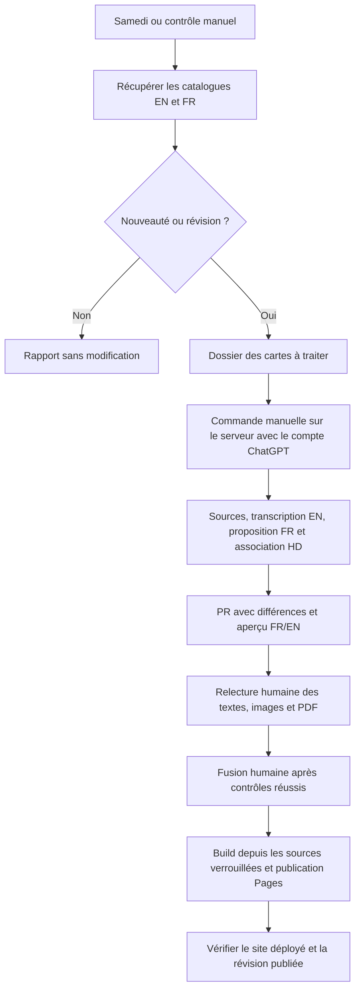

# Remise à plat du processus Coconut

Étude du 30 octobre 2026, basée sur `main` au commit `2781058`.
Ce document décrit le plan à mettre en œuvre ; il ne prétend pas que les
commandes et contrôles proposés existent déjà.

## Décisions prises avec l'utilisateur

- Garder le dépôt public, le site FR/EN et le CSV comme source éditable.
- Vérifier le catalogue chaque samedi à 08:17 UTC et à la demande.
- Préparer les nouvelles cartes avec Codex, mais toujours relire les textes,
  les sources et les rendus dans une PR avant fusion humaine.
- Utiliser le mini serveur personnel ; ses coordonnées restent hors du dépôt public.
- Utiliser le compte ChatGPT pour Codex, avec **traitement lancé manuellement**.
  L'utilisateur a retenu cette option après examen de la limite de la
  documentation officielle pour l'authentification ChatGPT en CI/CD publique.
- Ne pas faire tourner la session ChatGPT dans un job GitHub Actions.
- Conserver les traductions et associations déjà relues ; signaler toute
  révision distante, sans écrasement ni suppression automatiques.

## État constaté

| Élément | Constat vérifié |
| --- | --- |
| Génération | 29 cartes, images FR/EN et deux PDF, build local sans réseau |
| Données | CSV éditable et 58 JPEG sources verrouillés par SHA-256 |
| Détection distante | Maui — Half-Shark, `coconut-030`, manque au CSV |
| Autres écarts | Majuscules d'Ariel, Mickey Mouse et du Chaudron uniquement ; textes relus conservés |
| PR #11 | Fusionnée avec le manifeste de Maui uniquement, sans intégrer la carte |
| CI et Pages | Dernières exécutions sur `main` réussies |
| Tests locaux | 38 Python et 2 Node réussis avec Pillow 13.0.0 ; dépendances, compilation et build réussis |
| Faisabilité serveur | Audit réalisé ; coordonnées, accès et inventaire conservés uniquement dans le rapport local |
| Branches | 11 anciennes branches distantes supprimées après sauvegarde ; `main` conservée |
| Protection de main | API classique : `Branch not protected` ; aucun ruleset retourné pour le dépôt |

Le contrôle distant n'a pas comparé les octets des images : l'absence de
révision de JPEG n'est pas démontrée par ce contrôle.

La sauvegarde locale du nettoyage est conservée hors du dépôt public.
Le bundle contient l'historique complet et a été vérifié avec Git. Les
branches locales n'ont pas été supprimées. Les nouvelles branches de travail
seront supprimées après leur fusion, pas pendant une revue en cours.

## Processus cible

Un contrôle sans nouveauté n'a pas besoin de republier un site identique.
La publication suit la fusion d'une modification validée. Un déclenchement
manuel conserve la possibilité de reconstruire une révision de confiance.

### Détection et préparation sont distinctes

Le contrôle automatique reste déterministe et sans IA. Il sauvegarde un
rapport daté et les références des sources. Il compare aussi les changements
de cartes connues et les disparitions, au lieu de se limiter à `added`.
La comparaison d'empreintes JPEG doit être explicitement activée et rapportée.
Une panne d'API ne signifie jamais « aucune nouvelle carte ».

Le rapport alimente une PR brouillon de suivi, ou la PR de préparation déjà
ouverte, sans doublon. Une PR ne contenant que la détection ne doit pas être
fusionnable comme une intégration terminée. Le contrôle de préparation exige
le CSV complet, les sources, les empreintes et les rendus attendus.

### Commande manuelle de traitement

Prévoir une commande documentée qui reçoit un identifiant stable, par exemple
`coconut-030`. Le nom exact et les options seront fixés à l'itération 2.
La commande s'exécute dans une branche de travail issue de `main`, jamais
directement sur `main`, et réutilise le même dossier lors d'une relance.

1. Télécharger les JSON EN/FR et les images nécessaires avec délais, limites
   de taille et vérification du format. Conserver les extraits utiles,
   l'origine, les empreintes et les versions des outils pour la revue.
2. Lire l'image détaillée Coconut avec Codex et produire une transcription
   EN structurée. Les règles d'une carte standard ne servent jamais de
   remplacement à l'effet Coconut.
3. Proposer une traduction FR fondée sur la transcription, les formulations
   Lorcana et un glossaire tiré des corrections déjà validées. Garder les
   cibles, conditions, coûts, quantités, zones et temporalités.
4. Rechercher la correspondance standard EN/FR pour les noms et l'illustration
   haute résolution. Montrer les éléments de correspondance et le cadrage ;
   une ambiguïté bloque la préparation complète.
5. Produire un résultat JSON validé avant application au CSV. Un doute de
   lecture, de symbole ou d'association reste explicite ; pas de valeur
   inventée ni de remplacement silencieux d'un texte relu.
6. Générer un aperçu isolé FR/EN avec PDF pour la revue. Les nouvelles
   empreintes sont des propositions tant que les sources ne sont pas relues.
7. Mettre les fichiers attendus dans la PR et joindre un résumé de relecture.
   Les textes deviennent validés après la revue humaine et la fusion.

Les images et le JSON distants sont des données à analyser, jamais des
instructions à exécuter. Codex n'a pas à installer des outils, changer le
workflow, pousser sur `main`, fusionner ou publier pour transcrire une carte.
Limiter son rôle à la proposition structurée ; le programme valide et applique
les champs autorisés, puis des étapes explicites gèrent Git.

Les six marqueurs existants sont conservés : `{cost}`, `{lore}`, `{strength}`,
`{exert}`, `{ink}` et `{willpower}`. Ne pas confondre coût et encre. Les mots
clés utilisent le balisage gras existant. Les symboles, nombres et formulations
de ciblage nécessitent des contrôles dédiés, mais une simple égalité de
compteurs de symboles ne prouve pas la fidélité d'une traduction.

### Revue et publication

La PR présente l'image Coconut d'origine, l'illustration officielle retenue,
le texte EN, le texte FR, les différences, les incertitudes et les rendus.
Une source révisée montre l'ancien et le nouveau contenu. Toute modification
après approbation doit repasser les contrôles et la revue des fichiers modifiés.

La CI doit vraiment s'exécuter pour les PR créées par l'automatisation : ne
pas supposer qu'une PR créée avec `GITHUB_TOKEN` déclenche un nouvel événement
CI. Prévoir un déclenchement explicite du workflow de validation sur la branche
et vérifier le SHA contrôlé. Ce workflow n'a pas le droit de publier.

La protection de `main` doit imposer les contrôles de préparation et de build,
ainsi qu'une revue humaine, dans la mesure des possibilités du dépôt. Définir
les noms des contrôles après leur première exécution pour éviter une règle
qui attendrait un contrôle inexistant. Ne pas accorder à la préparation le
droit de contourner cette protection. Les réglages exacts seront présentés
avec la PR de workflow.

Après fusion humaine, reconstruire les fichiers depuis les sources locales
verrouillées et publier `dist/`. Inscrire le SHA publié dans un petit manifeste
du site pour vérifier que Pages sert bien la révision fusionnée. Contrôler
la page, les ressources des deux langues et les PDF, avec une courte période
de reprise en cas de propagation du déploiement.

### Répartition du serveur et de GitHub Actions

- Session personnelle manuelle : Codex connecté au compte ChatGPT, traitement
  assisté lancé par l'utilisateur et limites d'usage du compte applicables.
- Runner local éventuel : compte système dédié, distinct du compte qui
  conserve la session Codex ; uniquement tâches de confiance de build.
- PR publiques : validation sur les runners hébergés GitHub.
- Pages : publication par GitHub après fusion, sans session ChatGPT.

Le runner n'est pas nécessaire pour la commande manuelle. Installer d'abord
Codex et son authentification sur le serveur ; ajouter ensuite le runner si
le build local apporte un intérêt. Ne pas exposer le cache d'authentification
ChatGPT aux workflows. Une authentification expirée ou un quota atteint doit
produire une erreur exploitable, jamais une publication incomplète.

## Itérations et critères de sortie

Chaque itération de code suit : test métier en échec, implémentation minimale,
refactorisation, tests, documentation et revue de la PR. Garder la logique
de catalogue, la préparation IA et le rendu séparés par des entrées/sorties
simples, sans ajouter de couches sans usage concret.

| Itération | Livrable | Preuve attendue |
| --- | --- | --- |
| 0 — audit | Nettoyage des branches, sauvegarde et ce plan | Une seule ancienne branche distante conservée : main ; suite actuelle verte |
| 1 — contrat de revue | Schéma du dossier de proposition, états et validation de préparation | Une détection seule échoue au contrôle de préparation ; les textes relus restent identiques |
| 2 — sources | Récupération et préparation relançables pour une carte | Identifiant inconnu, API en panne, JPEG invalide, image révisée et doublon couverts par tests avec fixtures |
| 3 — Codex manuel | Adaptateur de commande, schéma JSON, glossaire et guide serveur | Réponse invalide, doute, délai dépassé et erreur de connexion bloquent ; aucun test ordinaire n'appelle le modèle |
| 4 — essai Maui | PR réelle avec transcription, traduction, association HD et aperçu | Validation utilisateur de l'EN, du FR, des sources, des JPEG et des PDF avant fusion |
| 5 — workflows | PR dédiée pour détection, validation, publication et réglages | Relance sans doublon, CI exécutée au bon SHA, aucune publication depuis une PR |
| 6 — recette | Fusion humaine puis contrôle du site publié | SHA, nouvelle carte, images FR/EN, liens PDF et impression cohérents |
| 7 — documentation | Guides courts, terminologie et nettoyage final | Une personne peut détecter, traiter, corriger, relire et diagnostiquer sans l'historique du chat |

Les changements de `AGENTS.md`, `.agents/` et `.github/workflows/` passent
dans une PR dédiée. Elle explicitera que l'IA peut **proposer** des textes et
des empreintes non validés ; leur acceptation reste humaine. Les règles
actuelles ne doivent pas être contournées en présentant une proposition
comme une source déjà approuvée.

### Scénarios de recette indispensables

- Aucune nouveauté : rapport réussi, pas de doublon de PR.
- Nouvelle carte : proposition complète et aperçus ; refus tant qu'il reste
  une incertitude ou un fichier requis absent.
- Deuxième exécution : même proposition, traductions corrigées conservées.
- Révision EN, image modifiée à URL constante et disparition de l'API :
  signalement et comparaison, aucune suppression ou acceptation automatique.
- JSON cassé, réseau indisponible, Codex absent ou réponse inutilisable :
  échec compréhensible, CSV existant intact et site publié inchangé.
- CSV corrigé après revue : CI à jour, nouvelle revue, publication après fusion.
- Carte dont le texte déborde : aperçu refusé avec l'identifiant de la carte.
- Déploiement réussi mais site ancien ou ressource absente : contrôle externe
  en échec, sans déclarer la recette terminée.

## Nettoyage et documentation

Conserver les sources, polices et licences, le CSV, les empreintes, les tests,
le code de rendu et le site. Ne pas supprimer des fichiers sur la seule base
de leur ancienneté. Le dépôt est déjà compact : le gain principal vient de la
suppression des procédures contradictoires et des états de revue périmés.

Après intégration de Maui, retirer son manifeste de détection ou le remplacer
par un état de suivi cohérent. Convertir les anciens points « à confirmer »
en historique daté sans inventer de validation. Mettre la spécification à jour :
elle annonce encore une extension bilingue en revue et une action Pages ne
copiant que `index.html`, alors que le workflow publie déjà tout `dist/`.
Vérifier aussi les affirmations du verrou contre ce qu'il enregistre réellement.

Organisation documentaire cible : README pour l'usage courant, SPEC pour les
contrats et critères, MAINTENANCE pour les procédures et le dépannage,
un guide serveur et un glossaire pour le traitement. Éviter de recopier les
horaires et chiffres de cartes dans plusieurs fichiers sans nécessité.
Ce plan pourra être réduit ou archivé une fois les itérations terminées.

## Références officielles consultées

- [Codex en mode non interactif](https://learn.chatgpt.com/docs/non-interactive-mode) :
  `codex exec`, sortie JSON avec schéma, réutilisation de l'authentification,
  et restriction de l'authentification ChatGPT en CI/CD publique.
- [Authentification de Codex](https://learn.chatgpt.com/docs/auth) : connexion
  sur serveur sans navigateur, notamment `codex login --device-auth` si disponible.
- [Référence CLI](https://learn.chatgpt.com/docs/developer-commands?surface=cli) :
  pièces jointes image et options de la commande ; confirmer les options de
  la version installée avant d'écrire le guide d'exécution définitif.
